<p align="center">
  
</p>

<h1 align="center">Hilo Headless CRM</h1>

<p align="center"><b>El CRM agentic-first: los agentes de IA operan el pipeline, las personas miran.</b></p>

<p align="center">
  <a href="https://github.com/jrcoronel-moon/hilo-crm/actions/workflows/ci.yml"></a>
  
  
  
  
  
  <a href="LICENSE"></a>
</p>

<p align="center"><a href="README.md">English</a> · <b>Español</b></p>

<p align="center">
  
</p>

Los CRM se diseñaron para que una persona haga clic en un tablero. Hilo está diseñado al revés: la vía principal es
un servidor [MCP](https://modelcontextprotocol.io) remoto y la web es una ventana para ver lo que los agentes hicieron.

Conectás Claude, ChatGPT, Grok o Cursor, y el agente carga empresas, contactos y oportunidades, registra cada
interacción y mueve el funnel. Entrás con Google o Microsoft cuando querés mirar.

Código libre, [Apache-2.0](LICENSE). Un `docker compose up` y anda.

<p align="center">
  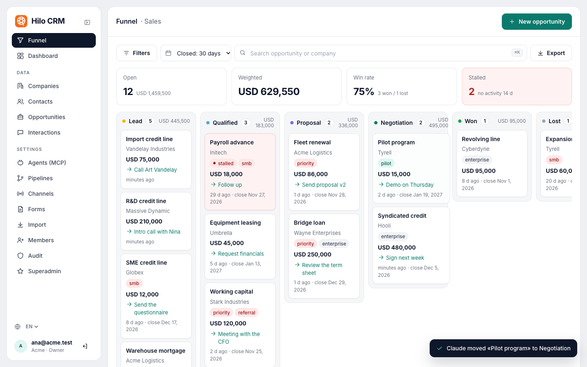
  <br><sub>El funnel se actualiza en vivo mientras un agente trabaja: acá Claude, conectado por MCP, mueve un deal a Negociación. Las capturas muestran la interfaz en inglés.</sub>
</p>

## El problema

Darle un CRM a un agente suele terminar de dos maneras: un agente que scrapea una interfaz pensada para dedos, o una
persona copiando datos de un chat a un formulario.

Hilo expone el CRM como herramientas MCP tipadas, y los `upsert` son idempotentes, así que el agente puede reintentar
sin duplicar nada. Cada llamada pasa por las mismas reglas de permisos y la misma auditoría que si la hubiera hecho
una persona: no hay un camino "de agente" con menos control.

| CRM de siempre | CRM con agente |
|---|---|
| Una persona carga los datos a mano. | El agente lee el mail, agenda la reunión, escribe la propuesta y registra cada paso. |
| Los datos envejecen apenas se cargan. | Cada dato entra cuando pasa, con su fecha real. |
| El pipeline refleja lo que alguien se acordó de escribir. | El pipeline refleja lo que pasó. |

## Qué hace un agente en un día de ventas

Un día concreto, de punta a punta: en cada hito, qué superficie usa el agente y qué deja escrito en Hilo.

> Ejemplo ilustrativo: las empresas, personas y montos son inventados. Algunas superficies dependen de que estén
> conectadas al agente y de que la otra parte lo permita.

| Hora | Qué hace el agente | Superficie | Qué queda en Hilo |
|---|---|---|---|
| 08:40 | **Revisa el buzón.** Llega una consulta de Marina Ríos, de Talleres Andinos. La clasifica como consulta comercial y la carga. | Buzón propio del agente | `upsert_company` + `upsert_contact` + `upsert_opportunity` en la etapa inicial, y `log_interaction` de tipo email, entrante, con el id del mensaje como `external_id`. |
| 09:15 | **Busca antecedentes.** Talleres Andinos ya existía: hay un deal viejo, perdido por precio. Lo anota en la oportunidad nueva para que nadie llegue a la reunión sin saberlo. | Hilo | `search_crm`, `get_company`, `get_timeline` y `upsert_opportunity` con la descripción actualizada. |
| 10:00 | **Arma la propuesta.** Completa la plantilla de Drive con monto, contactos y fecha estimada de cierre, y la guarda como Doc. | Drive y Docs | `upsert_opportunity` con el monto, la fecha de cierre y el link del documento en `links`. |
| 11:30 | **Agenda la reunión.** Crea el evento con el link de Meet y avanza la oportunidad de etapa. | Calendario y Meet | `move_opportunity_stage`, `next_step_at` con la fecha y `log_interaction` de tipo meeting, saliente. |
| 15:00 | **Entra a la reunión.** Si la herramienta está conectada y los participantes lo permiten, toma notas y escribe el resumen: pedidos, objeciones, próximo paso y fecha. | Videoconferencia | `log_interaction` con la duración y el resumen. |
| 16:20 | **Actualiza el deal.** Cambió el alcance: ajusta el monto, sube la probabilidad y deja el próximo paso con fecha. | Hilo | `upsert_opportunity` con `amount`, `probability`, `next_step` y `next_step_at`. |
| 17:45 | **Revisa qué quedó trabado.** Sin próximo paso, con cierre vencido o sin actividad hace dos semanas: le pasa la lista a la persona, con el motivo de cada una. | Hilo y el canal de la persona | `needs_attention`, que devuelve cada oportunidad con su motivo. |
| 18:10 | **Cierra el día.** Registra un resumen interno de lo que hizo. Nada se cargó a mano. | Hilo | `log_interaction` de tipo note, interna. |

En vez de ocho pedidos, un solo encargo al agente:

```text
Contexto: vendemos mantenimiento industrial a talleres medianos.
Un buen lead tiene planta propia y más de una máquina.

Hoy quiero que:
1. Revises el buzón y cargues en Hilo cada consulta nueva,
   con empresa, contacto y oportunidad en la etapa inicial.
2. Antes de responder, busques si el cliente ya existía
   y dejes anotado en la oportunidad lo que encuentres.
3. Armes la propuesta desde la plantilla de Drive
   y adjuntes el link al deal.
4. Agendes la reunión y dejes el próximo paso con fecha.
5. Al cierre del día, me pases la lista de oportunidades
   sin próximo paso o sin actividad hace dos semanas,
   con el motivo de cada una.

Reglas: no mandes ningún mail sin mostrármelo.
No prometas descuentos. Registrá cada interacción con su fecha real.
```

Cada uno de esos pasos es una llamada a una herramienta MCP: no hay un paso escondido donde alguien copia y pega. Y
si algo se corta a la mitad, el agente reintenta sin duplicar: los `upsert` resuelven por `id`, `external_id`,
dominio o email, y las interacciones aceptan un `external_id`, así que la segunda vez actualiza lo mismo en lugar de
crear otra copia.

## Las superficies

Hilo no lee mails ni entra a reuniones: eso lo hace el agente con las herramientas que tenga conectadas. Hilo es
donde termina el resultado.

| Superficie | Qué hace el agente | Qué escribe en Hilo |
|---|---|---|
| Buzón propio del agente | Con una dirección dedicada: recibe consultas, las clasifica, responde e hila las conversaciones. | Contacto, oportunidad e interacción, con el id del mensaje como `external_id` para que reintentar no duplique. Canal: Email. |
| Gmail u otro mail de la empresa | Busca conversaciones viejas para reconstruir el historial de un cliente y redacta respuestas para que la persona las apruebe. | Interacciones entrantes y salientes con su fecha real en `occurred_at`, no con la fecha en que se cargaron. |
| Calendario | Propone horarios, crea el evento y lo mueve si se cancela. | El `next_step_at` de la oportunidad y la interacción de tipo meeting. |
| Videoconferencia (Meet, Zoom, Teams) | Si la herramienta está conectada y los participantes lo permiten: entra, toma notas y saca el resumen. | La interacción con duración y el resumen de objeciones y próximos pasos. Canal: Videoconferencia. |
| Drive, Docs y Sheets | Lee plantillas, escribe la propuesta, mantiene una planilla de seguimiento y exporta el pipeline a CSV. | El link del documento en la oportunidad, y los montos y fechas de la planilla. Una planilla vieja se migra con `bulk_upsert`. |
| Redes sociales (X, LinkedIn, Reddit) | Publica, responde comentarios y detecta quién mostró interés, en las cuentas a las que tenga acceso. | Un contacto o una oportunidad con canal social (por ejemplo, LinkedIn), para medir qué canal trae deals y no solo visitas. |
| Formularios | Los completa una persona en tu web; el agente no interviene. | Contacto, oportunidad e interacción de tipo form, con canal Formulario. La auditoría registra que vino de un formulario, no de una persona ni de un agente. |

La gracia no es cada superficie por separado: es que todo termina en el mismo lugar. El agente usa las herramientas
que ya usa una persona, y Hilo es donde el resultado queda medido.

## Cómo se le pide algo

Un agente no es una app con botones: es alguien a quien le pedís cosas por escrito y que trabaja con las herramientas
que le diste. Funciona bien con cinco pasos.

1. **Contexto.** El agente no adivina: decile quién sos, qué vendés, qué es un buen lead y qué no. En Hilo eso se
   traduce en un pipeline con etapas claras y canales bien nombrados; si las etapas confunden a una persona, también
   confunden al agente.
   *"Vendemos mantenimiento industrial a talleres medianos. Un buen lead tiene planta propia y más de una máquina.
   Los estudiantes y proveedores no son leads."*
2. **Permiso.** El agente solo toca lo que le diste: sin calendario no agenda, sin buzón no lee mails. Un token de
   Hilo se puede restringir a solo lectura y nunca amplía lo que permite el rol de quien lo creó. Para empezar, uno de
   solo lectura alcanza para responder "cómo viene el mes" sin poder cambiar nada.
3. **Pedido concreto.** Qué mirar, qué hacer y qué devolver.
   Funciona: *"Buscá en el buzón las consultas de esta semana, cargalas en Hilo y decime cuáles necesitan respuesta
   hoy."* No funciona: *"Ocupate de las ventas."*
4. **Borrador antes de enviar.** Todo lo que sale hacia afuera se revisa: el agente redacta, la persona aprueba.
   *"Redactá la respuesta a Talleres Andinos con la propuesta adjunta. No la mandes, mostrámela."*
5. **Registro.** Lo que pasó queda en la interacción, con fecha. Si no quedó registrado, no pasó.
   *"Cuando la mande, registrala en Hilo como email saliente y dejá como próximo paso llamar el jueves."*

| Pedirle | No pedirle |
|---|---|
| Reconstruir el historial de un cliente desde el mail. | Prometer descuentos. |
| Preparar el resumen de una reunión. | Cerrar un deal. |
| Armar la propuesta desde una plantilla. | Mandar un mail sin revisión. |
| Mover deals trabados. | Decidir a qué cliente priorizar sin datos. |
| Avisar qué está por vencer. | |

**Qué sigue decidiendo la persona:** el precio, los compromisos, qué se manda hacia afuera y con quién conviene
invertir tiempo. El agente prepara, ordena y registra. La persona decide.

**El error más común** es pedirle que "mantenga el CRM al día" sin darle acceso al lugar donde pasa la información.
El CRM se mantiene porque el agente ve el mail y la reunión; sin eso tiene lo mismo que tenía la persona: nada que
cargar.

## Cómo se crea una rutina

Hasta acá el agente trabaja cuando le hablás. La diferencia grande aparece cuando no hace falta: una rutina es un
pedido que queda guardado y se vuelve a ejecutar solo, a la hora que digas o cuando pasa algo. No se configura en
ninguna pantalla: se pide en la misma conversación, tal cual.

```text
Todos los lunes a las 8:30, revisá Hilo y mandame por acá
las oportunidades que necesitan algo: próximas acciones
vencidas, cierres pasados y deals sin actividad hace más
de dos semanas. Para cada una decime el motivo y qué
propondrías hacer.

Si la semana no tiene nada para avisar, no me escribas.
```

El agente la guarda con día, hora y zona horaria, y se dispara sola aunque no estés mirando el chat. Se pausa, se
cambia o se borra pidiéndolo igual: *"pasá la rutina de los lunes a los martes a las 9"*.

Un pedido de rutina tiene que decir tres cosas:

1. **Cuándo:** un día y una hora, o una frecuencia (todos los lunes, cada mañana a las 8, el 1 de cada mes).
2. **Qué mirar:** Hilo, el buzón, el calendario. Sin esto el agente adivina, y adivinar es lo que sale mal.
3. **Qué devolver:** el formato, a dónde va (un mensaje, un correo, una nota en el deal) y cuándo callarse.

Cuatro rutinas que valen la pena el primer día:

| Rutina | Cuándo | Qué hace |
|---|---|---|
| El arranque del lunes | lunes 8:30 | Las oportunidades que necesitan algo, con el motivo y una propuesta de próximo paso. Usa `needs_attention`. |
| El cierre del día | todos los días 18:30 | Qué se movió hoy, qué se cargó y qué quedó sin registrar. Usa `list_changes` con el cursor de ayer. |
| El resumen del viernes | viernes 17:00 | Cómo viene el mes contra la meta, qué se ganó, qué se estancó y qué canales trajeron deals. Usa `get_metrics`. |
| El barrido del buzón | cada dos horas | Si entró una consulta nueva, la carga en Hilo y te avisa. Si no entró nada, no dice nada. |

Además del horario, una rutina puede esperar un evento:

```text
Cuando alguien complete el formulario de la web,
cargalo en Hilo con canal Formulario, avisame en el
momento y proponeme el primer mensaje de respuesta.
No lo mandes: mostrámelo.
```

Lo que hace que una rutina sirva es la última línea: cuándo no escribir. Un agente que avisa todos los días que no
pasó nada se vuelve ruido; el que solo aparece cuando hay algo, se lee.

## Qué ve la persona

La web es deliberadamente chica y hace solo lo que un agente no debería hacer: que un humano mire y decida.

- **Funnel** con arrastre entre etapas, deshacer y motivo de pérdida.
- **Dashboard** con volumen y valor ponderado por etapa, win rate, ciclo, tiempo en etapa, oportunidades estancadas,
  leads por canal, interacciones por semana, monto ganado por mes y objetivo mensual por pipeline.
- **Empresas, contactos y oportunidades**: listas, fichas con timeline, edición, tags con sugerencias, búsqueda,
  filtros, acciones en lote y exportación CSV.
- **Interacciones y auditoría** de todo lo que pasó, venga de un agente o de una persona.
- **En tiempo real**: mientras un agente trabaja, el funnel, las listas, las fichas y el dashboard se actualizan
  solos, con un aviso de quién hizo qué ("Claude movió «Planta solar» a Propuesta").
- **Ajustes**: pipelines, canales, formularios, miembros, dominios habilitados y marca de la aplicación (nombre y
  logo, configurables por el superadmin).
- **Seis idiomas**: inglés, español, francés, italiano, alemán y portugués. La interfaz sigue el idioma del navegador
  o el que elijas en el selector; montos y fechas usan el formato de cada idioma, y un workspace nuevo nace con su
  pipeline y sus canales en el idioma de quien lo crea.
- **En el celular**: una sola columna, un menú que se abre deslizando desde la izquierda, y tablas y funnel que se
  desplazan de costado dentro de su tarjeta.

| | |
|---|---|
| 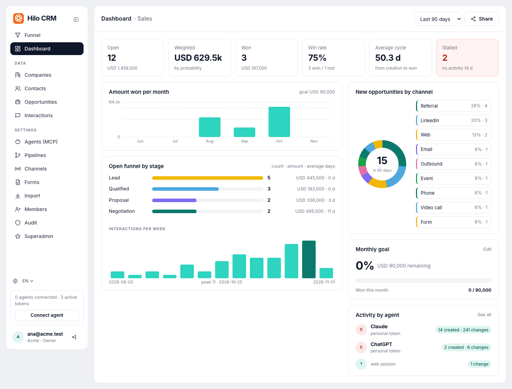 | 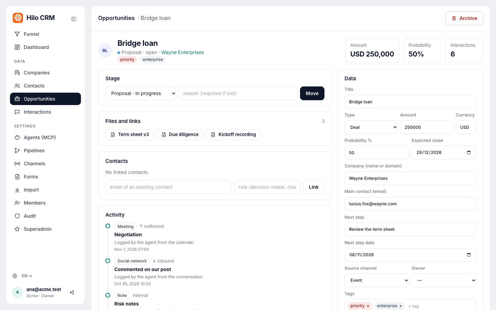 |
| **Dashboard**: pipeline ponderado, win rate, ciclo, objetivo y actividad por agente. | **Oportunidad**: etapa, links a archivos externos, contactos y el timeline que escribieron los agentes. |
| 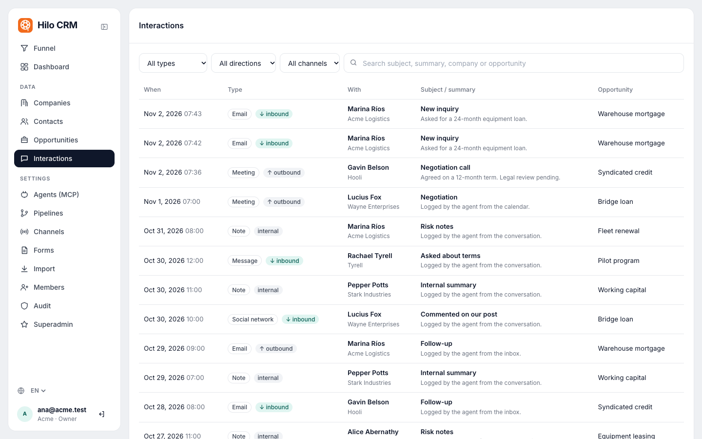 | 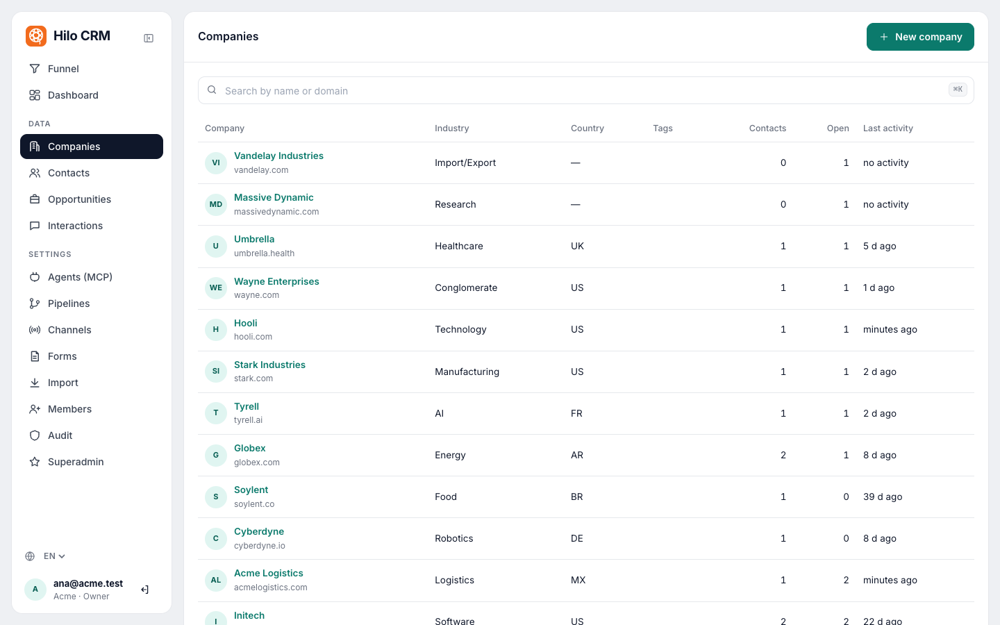 |
| **Interacciones**: cada email, llamada y reunión, con su fecha real. | **Empresas**, contactos y oportunidades, con búsqueda, filtros y acciones en lote. |
| 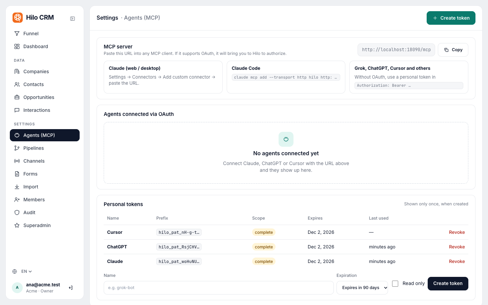 | 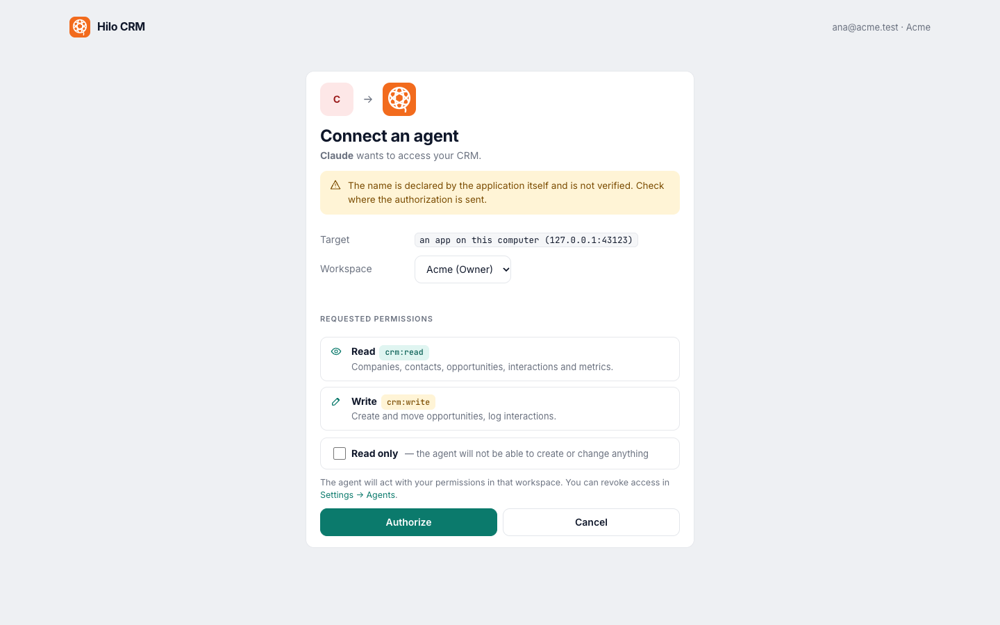 |
| **Agentes**: la URL MCP, los agentes conectados por OAuth y los tokens personales. | **Consentimiento**: lo que ve la persona cuando conecta un agente, con la opción de solo lectura. |
| 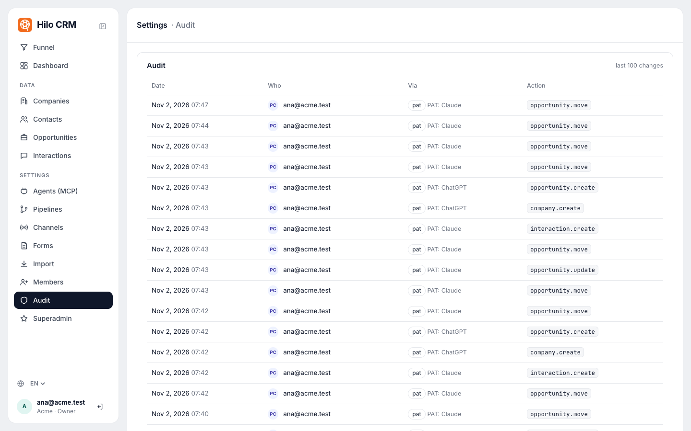 | 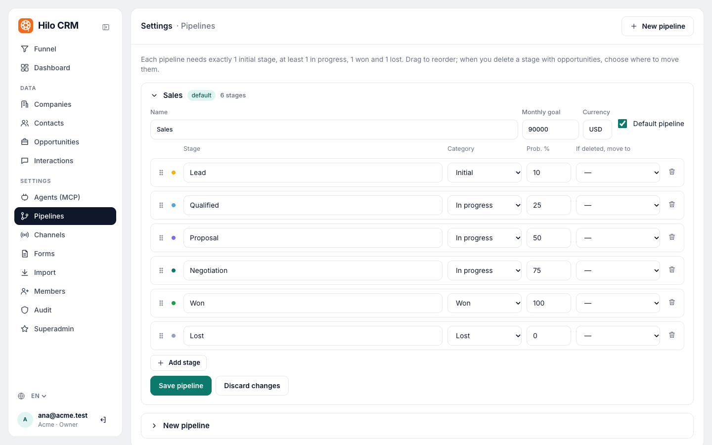 |
| **Auditoría**: quién hizo qué, persona o agente, y con qué cliente. | **Pipelines**: etapas, categorías, probabilidades y objetivo mensual. |
| 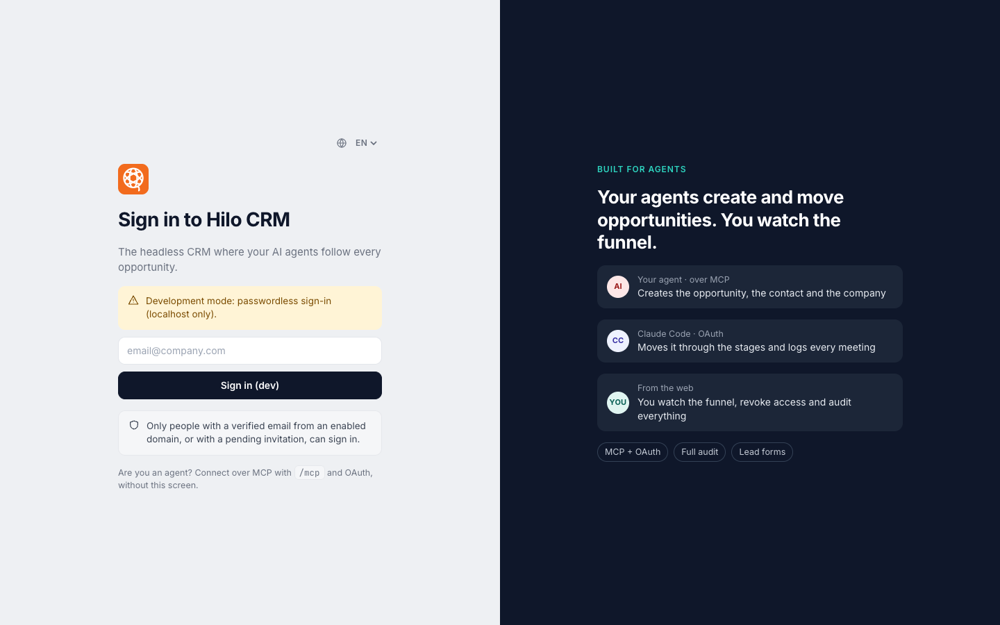 | 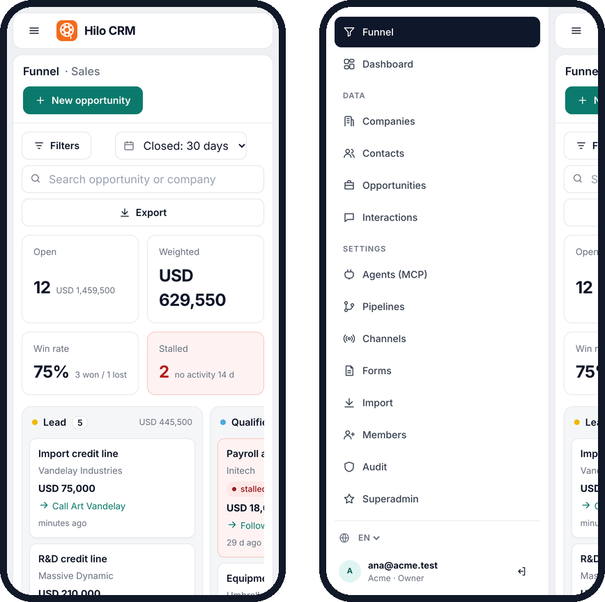 |
| **Entrar** con Google o Microsoft; los agentes se conectan por MCP. | **En el celular**: el funnel y el menú. |

## Empezar en local

Requisitos: Docker y Go 1.27+ (solo para desarrollar).

```sh
cp .env.example .env
# completá los secretos (el archivo explica cómo generarlos) y, para probar sin Google/Microsoft:
#   DEV_LOGIN_ENABLED=true   SUPERADMIN_EMAILS=vos@tuempresa.com
make up          # http://localhost:8080
```

Entrás con tu email (modo desarrollo), creás un workspace y en **Ajustes → Agentes** está la URL MCP.

<p align="center">
  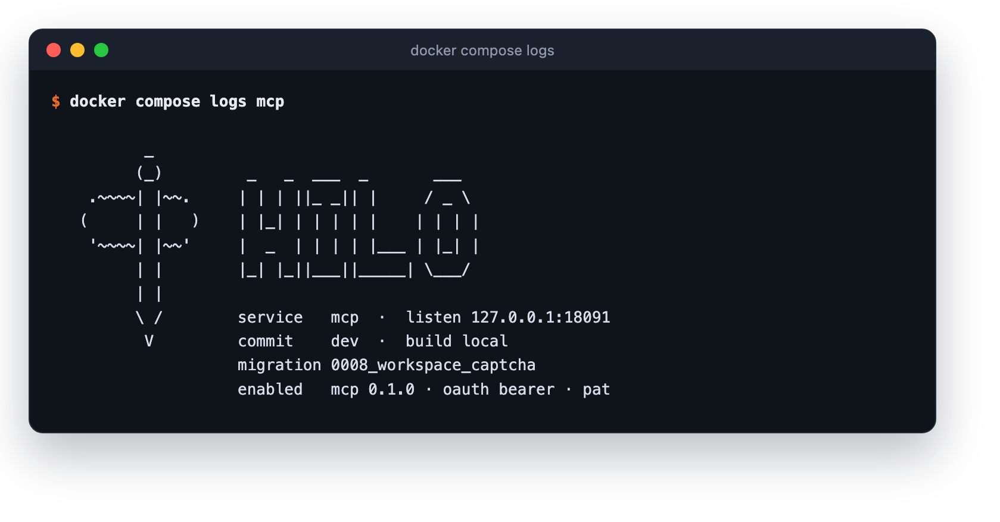
  <br><sub>Cada servicio imprime al arrancar un banner con su commit, su migración y lo que tiene habilitado.</sub>
</p>

## Conectar un agente

URL del servidor MCP: `https://<tu-dominio>/mcp`

- **Claude (web/desktop)**: Ajustes → Conectores → *Agregar conector personalizado* → pegá la URL. Se abre Hilo para
  iniciar sesión y autorizar; elegís el workspace y, si querés, acceso de solo lectura.
- **Claude Code**: `claude mcp add --transport http hilo https://<tu-dominio>/mcp`
- **Grok (API de xAI)**: herramienta `{"type": "mcp", "server_url": "https://<tu-dominio>/mcp", "authorization":
  "hilo_pat_…"}` en `/v1/responses` (el token solo: xAI agrega `Bearer`). Para probarlo contra tu stack local, con
  túnel incluido: `./scripts/try-grok.py`.
- **ChatGPT, Cursor, Duet, Muse y otros**: agregá la URL como servidor MCP remoto ([compatibilidad y guía por
  cliente](docs/AGENTS.md)). Si el cliente no soporta OAuth, creá un
  token personal en *Ajustes → Agentes* y mandalo como `Authorization: Bearer hilo_pat_…`.

### Herramientas MCP

El servidor expone 25 herramientas: todo lo que un agente necesita para operar el CRM, y nada más.

| Para qué | Herramientas |
|---|---|
| **Buscar y leer** (13): saber qué pasó antes de hacer algo | `search_crm` por nombre, dominio, email o título · `list_companies`, `list_contacts` filtrables por texto, dueño o etiqueta · `list_opportunities` por etapa, estado, dueño, canal, cierre o días sin actividad · `list_interactions` · `list_pipelines`, `list_channels`, `list_tags` para no inventar duplicados · `get_company`, `get_contact`, `get_opportunity` · `get_timeline` (interacciones y cambios de etapa) · `get_metrics` |
| **Escribir** (6): dejar asentado lo que el agente hizo o vio | `upsert_company`, `upsert_contact` (por id, `external_id`, dominio o email) · `upsert_opportunity` (monto, probabilidad, cierre, próximo paso, dueño, canal y links) · `move_opportunity_stage` (pasar a perdida exige motivo) · `log_interaction` (email, llamada, reunión, nota, mensaje, social o formulario; entrante, saliente o interna) · `archive_record` (no borra: saca el registro de las listas y lo deja en el historial y la auditoría) |
| **Trabajo en lote** (1): migrar en pocas llamadas | `bulk_upsert`: hasta 200 registros por llamada, con `dry_run` para validar una migración entera sin guardar |
| **Agentes que vuelven solos** (2) | `needs_attention`: oportunidades abiertas que necesitan a alguien, con el motivo (próximo paso vencido, cierre pasado, sin actividad, sin dueño, sin próximo paso) · `list_changes`: todo lo que cambió, con cursor, distinguiendo si lo hizo una persona, un agente o un formulario |
| **Administración** (3): solo admins | `configure_pipeline` (etapas en orden, con categoría y probabilidad) · `upsert_channel` · `export_records` (empresas, contactos u oportunidades en CSV, por partes si el workspace es grande) |

Las referencias entre registros aceptan el id de Hilo, la clave natural (dominio de la empresa, email del contacto) o
el `external_id` del sistema de origen, así que un agente que sincroniza o migra no necesita guardar ids.

Cada agente ve solo las herramientas que su rol y su token permiten. Un token OAuth o personal puede restringirse a
solo lectura; nunca puede ampliar lo que permite el rol.

### Pipelines y canales

Cada etapa tiene un nombre libre y una de cuatro categorías: `initial` (exactamente una), `in_progress` (al menos
una), `won` y `lost` (al menos una de cada). El estado de una oportunidad sigue a la categoría de su etapa, así que
las métricas no dependen de cómo nombraste las columnas.

Cada etapa tiene además una probabilidad, y eso es lo que hace que el monto ponderado signifique algo: el pipeline de
ventas viene con Lead 10 %, Calificado 25 %, Propuesta 50 %, Negociación 75 %, Ganado 100 % y Perdido 0 %. Un
pipeline se puede marcar como predeterminado y tener una meta mensual con moneda. Si se borra una etapa, hay que
reasignar sus oportunidades.

Los canales existen para responder una pregunta: qué trae deals, no solo visitas. Vienen diez de fábrica (Email,
Evento, Formulario, LinkedIn, Outbound, Referido, Teléfono, Video, Videoconferencia y Web), y cada uno tiene un tipo:
`web`, `form`, `email`, `phone`, `social`, `referral`, `event`, `outbound`, `partner`, `ads`, `videocall`, `video` u
`other`.

`get_metrics` mide volumen abierto y valor ponderado por etapa; ganadas y perdidas con montos y tasa de cierre; ciclo
promedio y días en cada etapa; oportunidades estancadas (14 días sin actividad) y nuevas por canal; interacciones por
semana y avance contra la meta del mes. La ventana por defecto es de 90 días.

### Formularios de leads

Los formularios públicos de leads crean contacto + oportunidad + interacción, sin poder sobrescribir datos existentes.
Cada formulario puede exigir un captcha de Cloudflare Turnstile (gratis), que Hilo verifica en el servidor antes de
guardar. Las claves son de cada workspace y las carga un admin desde la interfaz, sin tocar el servidor. Si el formulario tiene orígenes permitidos, el captcha tiene que haberse resuelto en uno de esos sitios.

Para activarlo, un admin del workspace:

1. En [dash.cloudflare.com](https://dash.cloudflare.com), entra a **Turnstile → Add widget** con los dominios de las
   webs donde van los formularios. Cloudflare le da una clave pública (site key) y una secreta (secret key).
2. En **Ajustes → Formularios → Captcha**, pega las dos claves y toca **Guardar claves**. La secreta se guarda
   cifrada y no se vuelve a mostrar: la pantalla indica que está guardada y sus últimos 4 caracteres.
3. Copia el snippet del formulario a su web (ya incluye el script y el widget de Turnstile) y después toca
   **Exigir captcha** en ese formulario.

Conviene respetar ese orden: si el captcha se activa antes de que la web tenga el widget, el formulario rechaza todos
los envíos. Sin claves guardadas, Hilo no deja activarlo, y no deja quitarlas mientras algún formulario lo exija. Los
formularios nuevos traen el captcha activado; los que ya existían siguen sin captcha hasta que se active.

## Quién puede entrar

Un email verificado por Google o Microsoft cuyo dominio esté habilitado por un superadmin, o con una invitación
pendiente. Sin dominios configurados, solo superadmins e invitados. Los superadmins se definen con
`SUPERADMIN_EMAILS` o con `hiloctl superadmin grant <email>`.

Nadie entra a un workspace sin aceptar: las invitaciones, y las que un workspace ofrece a todos los de su dominio de
email, esperan en la página de invitaciones hasta que la persona las acepta o rechaza. Un admin solo puede cargar el
dominio de su propio email. Solo el operador (`hiloctl member add`) agrega personas directamente.

| Rol | Puede |
|---|---|
| Lector | leer |
| Miembro | leer y escribir datos del CRM |
| Admin | además, configurar pipelines, canales, formularios, miembros y dominios |
| Propietario | además, gestionar propietarios |
| Superadmin (plataforma) | dominios habilitados para entrar, marca de la aplicación y vista de todos los workspaces |

### Un agente no tiene más permisos que una persona

Cada llamada de un agente pasa por las mismas reglas de permisos y la misma auditoría que si la hubiera hecho una
persona.

- **Scopes separados.** El servidor distingue `crm:read`, `crm:write` y `crm:admin`. Admin incluye configurar
  pipelines y canales, y usar fechas históricas para migraciones. Un token de solo lectura es de solo lectura de
  verdad.
- **Quién hizo qué.** `list_changes` y la auditoría distinguen si un cambio lo hizo una persona, un agente o un
  formulario.
- **Historia completa.** Todo se ve en el timeline de cada oportunidad y en el registro de auditoría del workspace.
- **Archivar no es borrar.** `archive_record` saca el registro de las listas y lo deja en el historial y en la
  auditoría.

## Administrar desde la terminal

Todo lo de workspaces, miembros y tokens se puede hacer sin abrir la web, con `hiloctl` dentro del contenedor
`web` (en el servidor, por SSH):

```sh
docker compose exec web hiloctl workspace create "Acme" --owner ana@acme.com
docker compose exec web hiloctl member add acme bob@acme.com member      # si nunca entró, queda invitado
docker compose exec web hiloctl token create acme ana@acme.com grok --read-only --ttl 90d
docker compose exec web hiloctl --json member list acme
docker compose exec web hiloctl client preapprove acme <client-id-url>     # copiado de Ajustes → Agentes
docker compose exec web hiloctl watch acme                                # lo que hacen los agentes, en vivo
docker compose exec -T web hiloctl pipeline apply acme < pipeline.json    # pipelines, canales, auditoría, marca…
docker compose exec -T web hiloctl export acme > acme.json                 # todo el workspace, en JSON
docker compose exec -T web hiloctl import otro --dry-run < acme.json       # validar; sin --dry-run, cargar
docker compose exec -T web hiloctl import-csv acme contact --source hubspot --dry-run < contacts.csv   # un CSV de otro CRM
```

Manual completo, con pasos y recetas: [docs/HILOCTL.md](docs/HILOCTL.md).

<p align="center">
  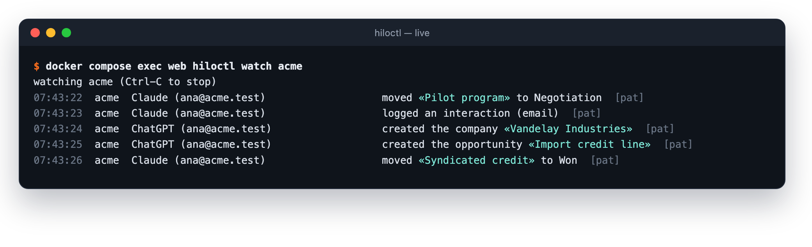
  <br><sub><code>hiloctl watch</code>: cada cambio en el momento, y qué agente lo hizo y para quién.</sub>
</p>

| | |
|---|---|
| 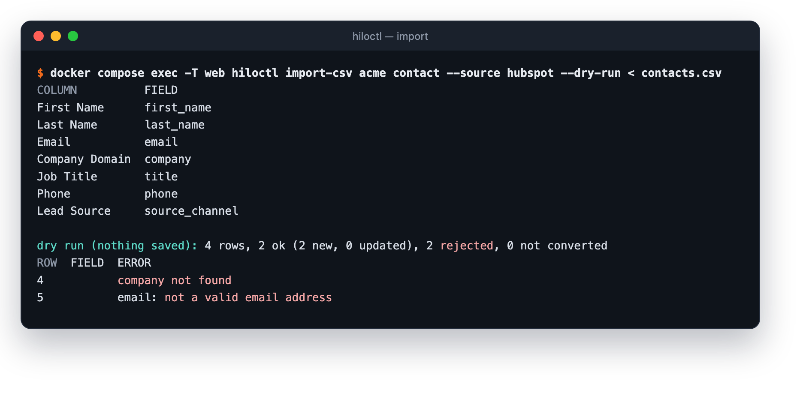 | 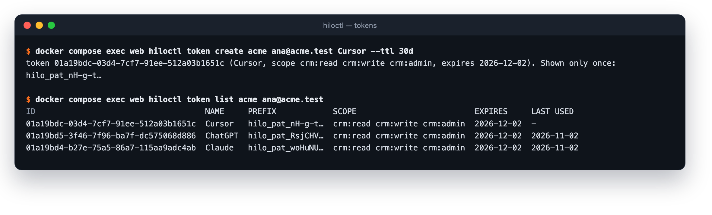 |
| **Importar un CSV** de otro CRM: mapeo de columnas y prueba antes de guardar. | **Tokens personales** para agentes sin OAuth, que se muestran una sola vez. |

`export` produce el mismo formato que lee `import` (y la herramienta `bulk_upsert`): sirve de backup legible, para
mover un workspace a otro Hilo y como formato de migraciones grandes sin agente. Importarlo de nuevo nunca duplica.

Un CSV de otro CRM o de una planilla se carga desde *Ajustes → Importar* (un tipo de registro por archivo: Hilo
reconoce las columnas en español o inglés, te deja ajustarlas y valida todo con una prueba antes de guardar) o con
`hiloctl import-csv` para archivos grandes. Ambos pasan por los mismos `upsert` que usan los agentes.

*Ajustes → Exportar* descarga empresas, contactos u oportunidades en CSV, un archivo por tipo, con las columnas que
lee Importar: los archivos se cargan tal cual en otro workspace (empresas, después contactos, después
oportunidades). Los agentes obtienen los mismos archivos con `export_records`. Solo exportan los admins, y cada
exportación queda en la auditoría.

`hiloctl` sin argumentos lista todos los comandos. Actúa como operador del servidor, con las mismas reglas que la
web (por ejemplo, ningún workspace se queda sin propietario). El token se muestra una sola vez.

Con `HILO_UI=minimal` la web queda reducida a lo que necesita el OAuth de los agentes (iniciar sesión y
consentimiento) y todo lo demás se administra con `hiloctl`; con `HILO_UI=off` no hay páginas ni OAuth, y los agentes
entran con tokens personales emitidos por `hiloctl`.

Un agente pre-aprobado se conecta sin pantalla de consentimiento: la persona solo elige su cuenta de Google o
Microsoft (si hay un único proveedor configurado, Hilo la lleva directo). Se pre-aprueba con la URL que identifica al
agente (su `client_id`, visible en *Ajustes → Agentes* después de conectarlo una vez), con lectura y escritura o
solo lectura, y nunca con permisos de administración.

## Arquitectura

```
                 ┌──────────── edge ─────────────┐        ┌──────── data (interna) ────────┐
 navegador ─┐    │  caddy ──► web  (UI, OAuth,   │        │                                │
 agentes ───┴──► │   TLS       formularios)  ────┼────────┼──► postgres (RLS)  ◄── migrate │
   (MCP)         │        └─► mcp  (/mcp)    ────┼────────┼──►                 ◄── backup  │
                 └───────────────────────────────┘        └────────────────────────────────┘
```

| Contenedor | Rol |
|---|---|
| `caddy` | Único punto expuesto. TLS automático (Let's Encrypt), límite de cuerpo, compresión. |
| `web` | Login Google/Microsoft, consentimiento OAuth, tablero, dashboard, ajustes, superadmin, endpoint de formularios. |
| `mcp` | Servidor MCP sin estado. Solo valida tokens; nunca los emite. |
| `db` | Postgres 18. Sin puertos publicados, en una red sin salida a internet. |
| `migrate` | Aplica migraciones con el rol `hilo_migrator` y termina. |
| `backup` | `pg_dump` diario comprimido, con retención configurable. |

Stack: Go 1.27, `net/http`, pgx + sqlc (SQL tipado, sin SQL dinámico), el SDK oficial de MCP para Go,
`html/template`, Postgres 18, Caddy 2.

## Seguridad

Está pensado para correr expuesto a internet, porque un servidor MCP remoto tiene que estarlo.

- MCP remoto (Streamable HTTP) con **OAuth 2.1**: registro dinámico de clientes, Client ID Metadata Documents, PKCE
  obligatorio, rotación de refresh tokens y tokens personales para clientes sin OAuth.
- **Multi-workspace** con Postgres Row-Level Security y FKs compuestas por workspace.
- Roles de base de datos de mínimo privilegio, contenedores sin root y de solo lectura.
- CSP estricta.

## Desarrollo y harness de calidad

```sh
make hooks     # pre-commit: formato, secretos en lo staged, lint
make test      # tests unitarios, de integración y E2E contra Postgres real (con -race y cobertura)
make check     # todo lo de CI: formato, código generado, lint, tests, govulncheck, gitleaks, hadolint, Trivy
make dast      # OWASP ZAP baseline contra el stack levantado (make up)
```

| Capa | Herramienta |
|---|---|
| Lint y seguridad estática | golangci-lint: gosec, errcheck, dupl (código repetido), gocognit, staticcheck, revive… |
| Secretos | gitleaks (árbol y todo el historial) con reglas para los tokens de Hilo |
| Dependencias | govulncheck, Trivy, Dependabot |
| Contenedores | hadolint, Trivy sobre las imágenes |
| Tests | aislamiento entre tenants, matriz de permisos, flujo OAuth completo con ataques, CSRF, XSS, open redirect, fuzzing |
| DAST | OWASP ZAP baseline |

## Licencia

[Apache-2.0](LICENSE): uso libre, comercial y privado.

Documentación: [despliegue (Docker, Lightsail, EC2 + Aurora)](docs/DEPLOY.md) · [manual de hiloctl](docs/HILOCTL.md) · [seguridad y modelo de amenazas](SECURITY.md) ·
[banner de arranque](docs/STARTUP_BANNER.md) · [migrar desde otro CRM con un agente](docs/migrate/README.md) ·
[cómo contribuir](CONTRIBUTING.md) ·
[plan de próximos features](docs/PLAN_FEATURES.md).
