<p align="center">
  
</p>

<h1 align="center">Hilo Headless CRM</h1>

<p align="center"><b>The agentic-first CRM: AI agents run the pipeline, people watch.</b></p>

<p align="center">
  <a href="https://github.com/jrcoronel-moon/hilo-crm/actions/workflows/ci.yml"></a>
  
  
  
  
  
  <a href="LICENSE"></a>
</p>

<p align="center"><b>English</b> · <a href="README.es.md">Español</a></p>

<p align="center">
  
</p>

CRMs were designed for a person clicking around a board. Hilo is built the other way around: the main way in is a
remote [MCP](https://modelcontextprotocol.io) server, and the web is a window to see what the agents did.

Connect Claude, ChatGPT, Grok or Cursor, and the agent loads companies, contacts and opportunities, logs every
interaction and moves the funnel. You sign in with Google or Microsoft when you want to look.

Open source, [Apache-2.0](LICENSE). One `docker compose up` and it runs.

<p align="center">
  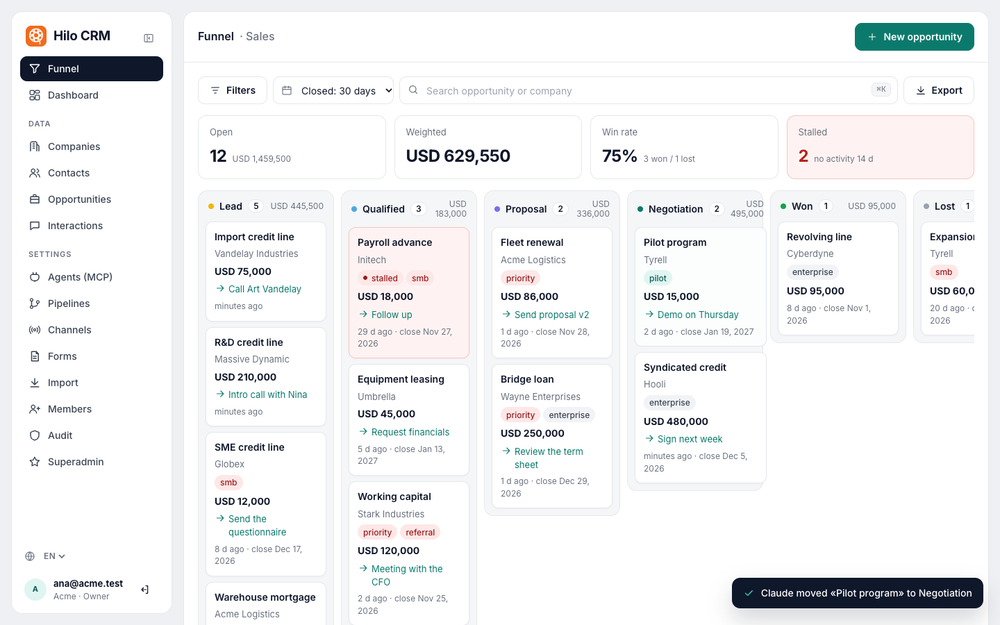
  <br><sub>The funnel updates live while an agent works: here Claude, connected over MCP, moves a deal to Negotiation.</sub>
</p>

## The problem

Giving a CRM to an agent usually ends one of two ways: an agent scraping an interface built for fingers, or a person
copying data from a chat into a form.

Hilo exposes the CRM as typed MCP tools, and the `upsert`s are idempotent, so the agent can retry without duplicating
anything. Every call goes through the same permission rules and the same audit as if a person had made it: there is
no "agent path" with less control.

| The usual CRM | A CRM with an agent |
|---|---|
| A person types the data in by hand. | The agent reads the email, books the meeting, writes the proposal and records every step. |
| Data goes stale as soon as it is entered. | Every fact comes in when it happens, with its real date. |
| The pipeline shows what someone remembered to write down. | The pipeline shows what happened. |

## What an agent does in a sales day

One concrete day, end to end: at each step, which surface the agent uses and what it writes in Hilo.

> Illustrative example: the companies, people and amounts are made up. Some surfaces depend on being connected to the
> agent and on the other party allowing it.

| Time | What the agent does | Surface | What lands in Hilo |
|---|---|---|---|
| 08:40 | **Checks the inbox.** An inquiry arrives from Marina Ríos at Talleres Andinos. It classifies it as a sales inquiry and loads it. | The agent's own inbox | `upsert_company` + `upsert_contact` + `upsert_opportunity` in the initial stage, and `log_interaction` of type email, inbound, with the message id as `external_id`. |
| 09:15 | **Looks for history.** Talleres Andinos already existed: there is an old deal, lost on price. It notes this on the new opportunity so nobody walks into the meeting without knowing. | Hilo | `search_crm`, `get_company`, `get_timeline` and `upsert_opportunity` with the updated description. |
| 10:00 | **Drafts the proposal.** Fills in the Drive template with amount, contacts and expected close date, and saves it as a Doc. | Drive and Docs | `upsert_opportunity` with the amount, the close date and the document link in `links`. |
| 11:30 | **Books the meeting.** Creates the event with the Meet link and moves the opportunity forward. | Calendar and Meet | `move_opportunity_stage`, `next_step_at` with the date and `log_interaction` of type meeting, outbound. |
| 15:00 | **Joins the meeting.** If the tool is connected and the participants allow it, it takes notes and writes the summary: requests, objections, next step and date. | Video call | `log_interaction` with the duration and the summary. |
| 16:20 | **Updates the deal.** The scope changed: it adjusts the amount, raises the probability and sets the next step with a date. | Hilo | `upsert_opportunity` with `amount`, `probability`, `next_step` and `next_step_at`. |
| 17:45 | **Checks what got stuck.** No next step, close date passed or no activity for two weeks: it hands the list to the person, with the reason for each. | Hilo and the person's channel | `needs_attention`, which returns each opportunity with its reason. |
| 18:10 | **Wraps up the day.** Logs an internal summary of what it did. Nothing was typed in by hand. | Hilo | `log_interaction` of type note, internal. |

Instead of eight requests, a single brief to the agent:

```text
Context: we sell industrial maintenance to mid-sized workshops.
A good lead has its own plant and more than one machine.

Today I want you to:
1. Check the inbox and load every new inquiry into Hilo,
   with company, contact and an opportunity in the initial stage.
2. Before replying, check whether the customer already existed
   and note on the opportunity what you find.
3. Draft the proposal from the Drive template
   and attach the link to the deal.
4. Book the meeting and set the next step with a date.
5. At the end of the day, send me the list of opportunities
   with no next step or no activity for two weeks,
   with the reason for each.

Rules: don't send any email without showing it to me.
Don't promise discounts. Log every interaction with its real date.
```

Each of those steps is a call to an MCP tool: there is no hidden step where someone copies and pastes. And if
something breaks halfway, the agent retries without duplicating: the `upsert`s resolve by `id`, `external_id`,
domain or email, and interactions accept an `external_id`, so the second time updates the same record instead of
creating another copy.

## The surfaces

Hilo does not read email or join meetings: the agent does that with the tools it has connected. Hilo is where the
result ends up.

| Surface | What the agent does | What it writes in Hilo |
|---|---|---|
| The agent's own inbox | With a dedicated address: receives inquiries, classifies them, replies and threads conversations. | Contact, opportunity and interaction, with the message id as `external_id` so retries don't duplicate. Channel: Email. |
| Gmail or another company mailbox | Searches old conversations to rebuild a customer's history and drafts replies for the person to approve. | Inbound and outbound interactions with their real date in `occurred_at`, not the date they were loaded. |
| Calendar | Proposes times, creates the event and moves it if it is cancelled. | The opportunity's `next_step_at` and the meeting interaction. |
| Video calls (Meet, Zoom, Teams) | If the tool is connected and the participants allow it: joins, takes notes and writes the summary. | The interaction with its duration and the summary of objections and next steps. Channel: Video call. |
| Drive, Docs and Sheets | Reads templates, writes the proposal, keeps a tracking sheet and exports the pipeline to CSV. | The document link on the opportunity, and the amounts and dates from the sheet. An old spreadsheet is migrated with `bulk_upsert`. |
| Social media (X, LinkedIn, Reddit) | Posts, answers comments and spots who showed interest, on the accounts it has access to. | A contact or an opportunity with a social channel (for example, LinkedIn), to measure which channel brings deals and not just visits. |
| Forms | A person fills them in on your website; the agent is not involved. | Contact, opportunity and an interaction of type form, with the Form channel. The audit records that it came from a form, not from a person or an agent. |

The point is not each surface on its own: it is that everything ends up in the same place. The agent uses the tools a
person already uses, and Hilo is where the result is measured.

## How to ask an agent for something

An agent is not an app with buttons: it is someone you ask for things in writing and who works with the tools you gave
it. It works well with five steps.

1. **Context.** The agent doesn't guess: tell it who you are, what you sell, what a good lead is and what isn't. In
   Hilo that translates into a pipeline with clear stages and well-named channels; if the stages confuse a person,
   they confuse the agent too.
   *"We sell industrial maintenance to mid-sized workshops. A good lead has its own plant and more than one machine.
   Students and suppliers are not leads."*
2. **Permission.** The agent only touches what you gave it: no calendar, no booking; no inbox, no reading email. A
   Hilo token can be restricted to read-only and never widens what the role of its creator allows. To start, a
   read-only one is enough to answer "how is the month going" without being able to change anything.
3. **A concrete request.** What to look at, what to do and what to return.
   Works: *"Search the inbox for this week's inquiries, load them into Hilo and tell me which need a reply today."*
   Doesn't work: *"Take care of sales."*
4. **Draft before sending.** Everything that goes out gets reviewed: the agent drafts, the person approves.
   *"Draft the reply to Talleres Andinos with the proposal attached. Don't send it, show it to me."*
5. **Record.** What happened goes into the interaction, with a date. If it wasn't recorded, it didn't happen.
   *"When you send it, log it in Hilo as an outbound email and set calling on Thursday as the next step."*

| Ask it to | Don't ask it to |
|---|---|
| Rebuild a customer's history from email. | Promise discounts. |
| Prepare a meeting summary. | Close a deal. |
| Draft the proposal from a template. | Send an email without review. |
| Move stuck deals. | Decide which customer to prioritize without data. |
| Warn about what is about to expire. | |

**What the person still decides:** price, commitments, what goes out and where it is worth spending time. The agent
prepares, organizes and records. The person decides.

**The most common mistake** is asking it to "keep the CRM up to date" without giving it access to where the
information happens. The CRM stays current because the agent sees the email and the meeting; without that it has
what the person had: nothing to load.

## How to create a routine

So far the agent works when you talk to it. The big difference comes when you don't have to: a routine is a request
that is saved and runs again on its own, at the time you say or when something happens. There is no settings screen:
you ask for it in the same conversation, as is.

```text
Every Monday at 8:30, check Hilo and send me here
the opportunities that need something: overdue next
steps, passed close dates and deals with no activity
for more than two weeks. For each one tell me the
reason and what you would propose doing.

If the week has nothing to report, don't write to me.
```

The agent saves it with day, time and time zone, and it fires on its own even if you are not looking at the chat. It
is paused, changed or deleted the same way: *"move the Monday routine to Tuesdays at 9"*.

A routine request has to say three things:

1. **When:** a day and a time, or a frequency (every Monday, every morning at 8, the 1st of each month).
2. **What to look at:** Hilo, the inbox, the calendar. Without this the agent guesses, and guessing is what goes wrong.
3. **What to return:** the format, where it goes (a message, an email, a note on the deal) and when to stay quiet.

Four routines worth having on day one:

| Routine | When | What it does |
|---|---|---|
| The Monday kickoff | Monday 8:30 | The opportunities that need something, with the reason and a proposed next step. Uses `needs_attention`. |
| The end of the day | every day 18:30 | What moved today, what was loaded and what was left unrecorded. Uses `list_changes` with yesterday's cursor. |
| The Friday summary | Friday 17:00 | How the month is doing against the goal, what was won, what stalled and which channels brought deals. Uses `get_metrics`. |
| The inbox sweep | every two hours | If a new inquiry came in, it loads it into Hilo and tells you. If nothing came in, it says nothing. |

Besides a schedule, a routine can wait for an event:

```text
When someone fills in the form on the website,
load it into Hilo with the Form channel, tell me
right away and propose the first reply.
Don't send it: show it to me.
```

What makes a routine useful is the last line: when not to write. An agent that reports every day that nothing
happened becomes noise; the one that only shows up when there is something gets read.

## What the person sees

The web is deliberately small and does only what an agent shouldn't: let a human look and decide.

- **Funnel** with drag between stages, undo and loss reason.
- **Dashboard** with volume and weighted value per stage, win rate, cycle, time in stage, stalled opportunities,
  leads by channel, interactions per week, amount won per month and a monthly goal per pipeline.
- **Companies, contacts and opportunities**: lists, records with a timeline, editing, tags with suggestions, search,
  filters, bulk actions and CSV export.
- **Interactions and audit** of everything that happened, whether it came from an agent or a person.
- **Real time**: while an agent works, the funnel, lists, records and dashboard update on their own, with a notice of
  who did what ("Claude moved «Solar plant» to Proposal").
- **Settings**: pipelines, channels, forms, members, allowed domains and application branding (name and logo,
  configurable by the superadmin).
- **Six languages**: English, Spanish, French, Italian, German and Portuguese. The interface follows the browser's
  language or the one you pick in the selector; amounts and dates use each language's format, and a new workspace
  starts with its pipeline and channels in its creator's language.
- **Works on a phone**: one column, a menu drawer you open with a swipe from the left, and tables and the funnel that
  scroll sideways inside their card.

| | |
|---|---|
| 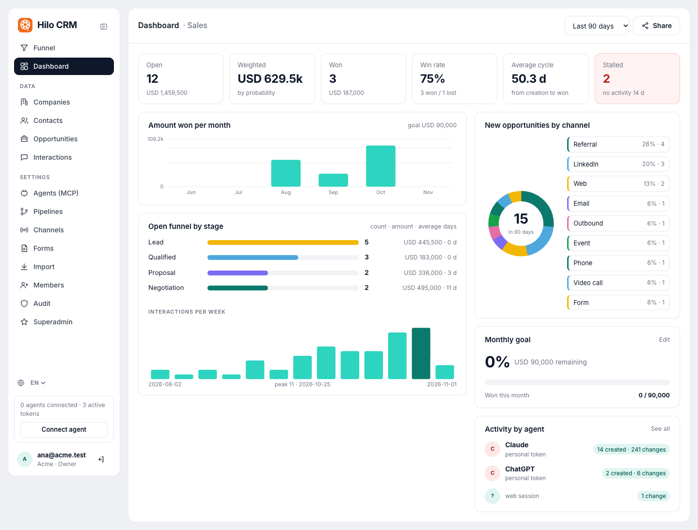 | 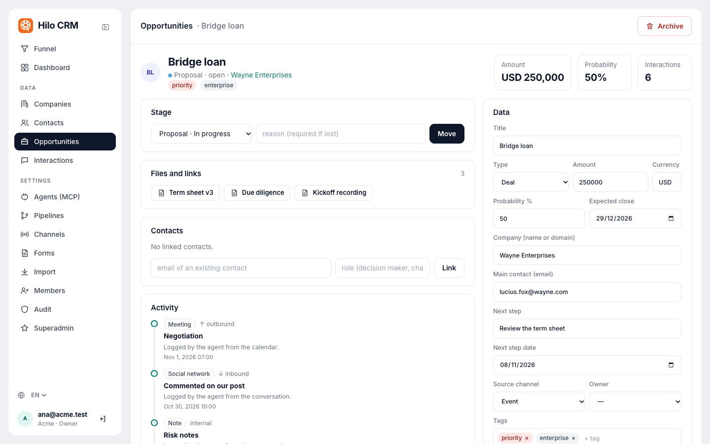 |
| **Dashboard**: weighted pipeline, win rate, cycle, goal and activity by agent. | **Opportunity**: stage, links to external files, contacts and the timeline the agents wrote. |
| 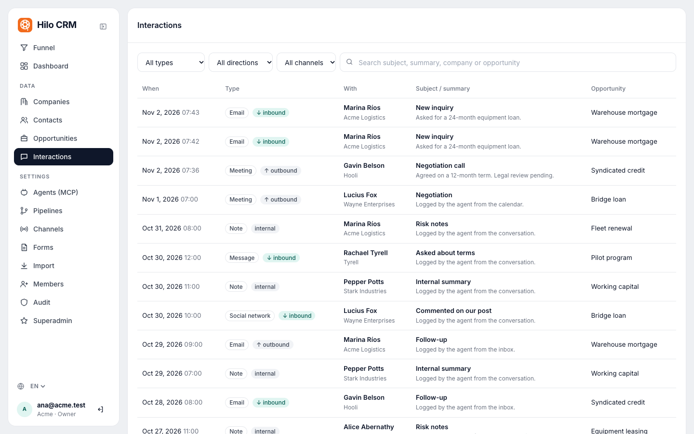 | 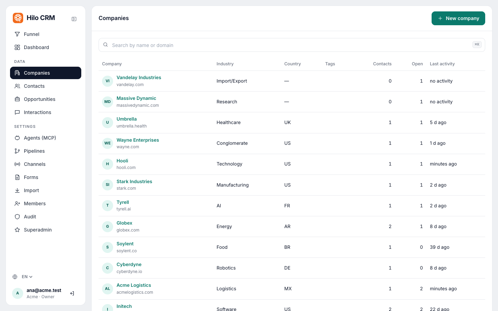 |
| **Interactions**: every email, call and meeting, with its real date. | **Companies**, contacts and opportunities, with search, filters and bulk actions. |
| 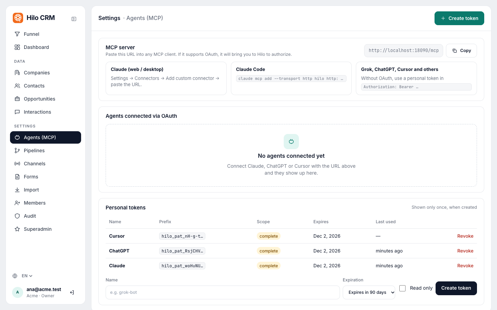 | 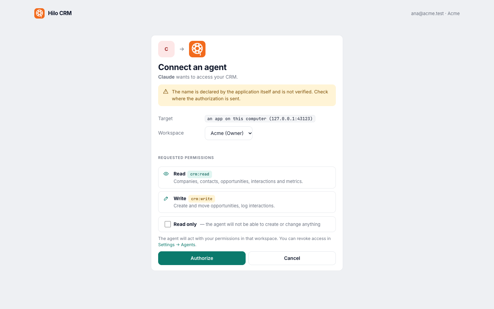 |
| **Agents**: the MCP URL, agents connected over OAuth and personal tokens. | **Consent**: what an agent sees when it connects, with read-only as an option. |
| 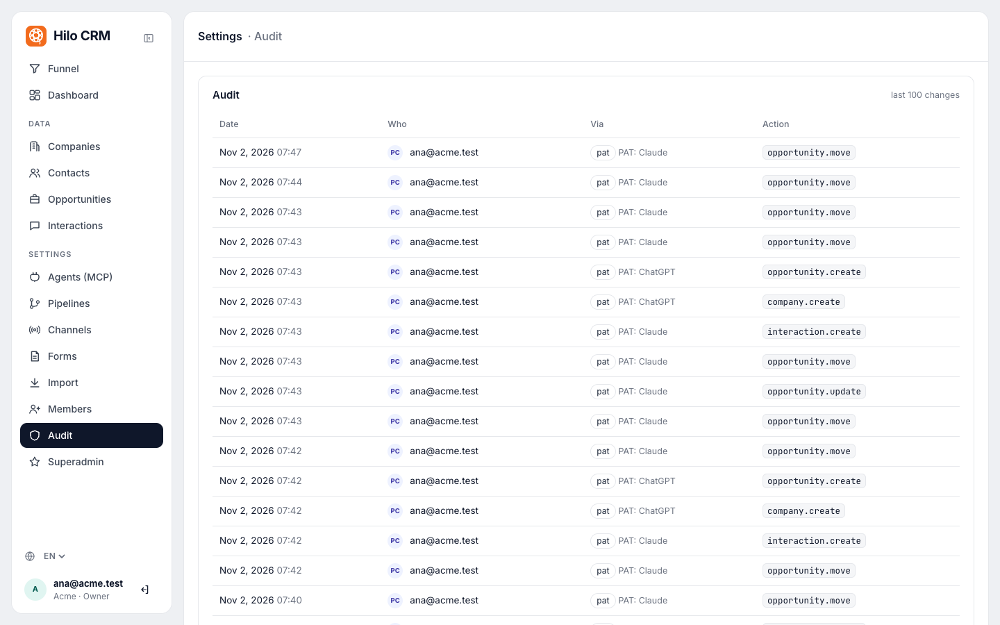 | 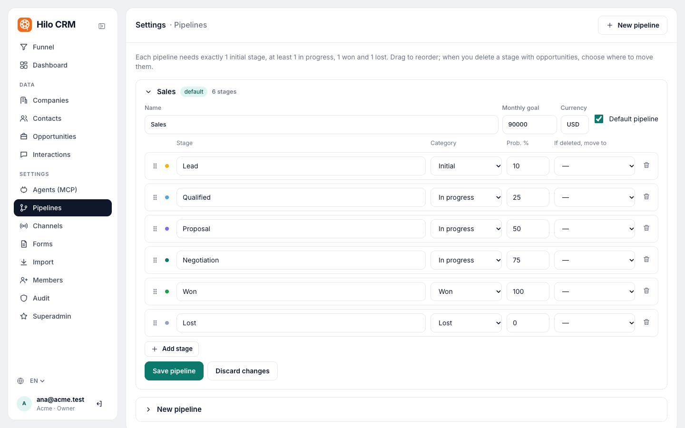 |
| **Audit**: who did what, person or agent, with the client it used. | **Pipelines**: stages, categories, probabilities and a monthly goal. |
| 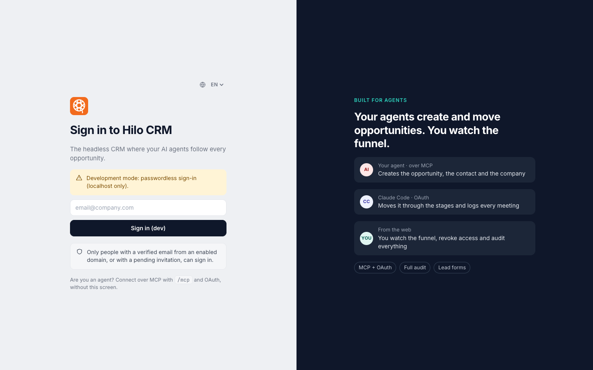 | 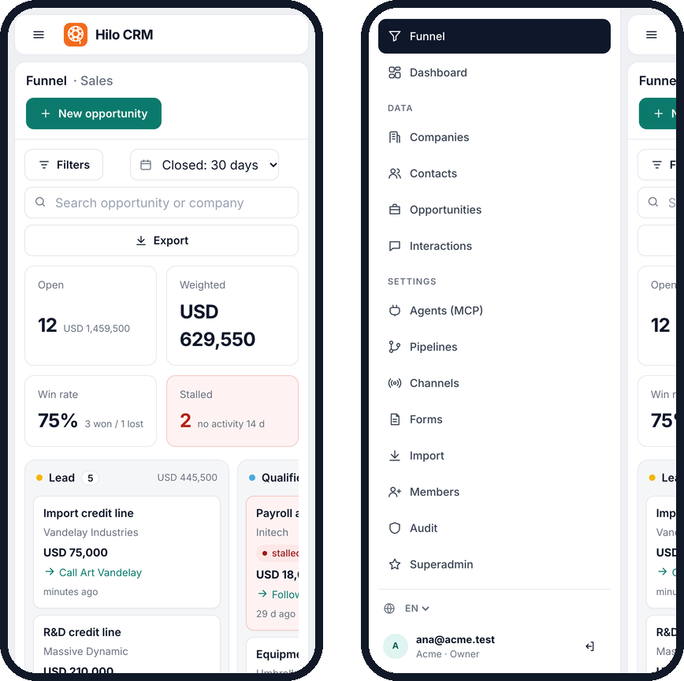 |
| **Sign in** with Google or Microsoft; agents connect over MCP. | **On a phone**: the funnel and the menu drawer. |

## Run it locally

Requirements: Docker, and Go 1.27+ (only to develop).

```sh
cp .env.example .env
# fill in the secrets (the file explains how to generate them) and, to try it without Google/Microsoft:
#   DEV_LOGIN_ENABLED=true   SUPERADMIN_EMAILS=you@yourcompany.com
make up          # http://localhost:8080
```

You sign in with your email (development mode), create a workspace, and the MCP URL is in **Settings → Agents**.

<p align="center">
  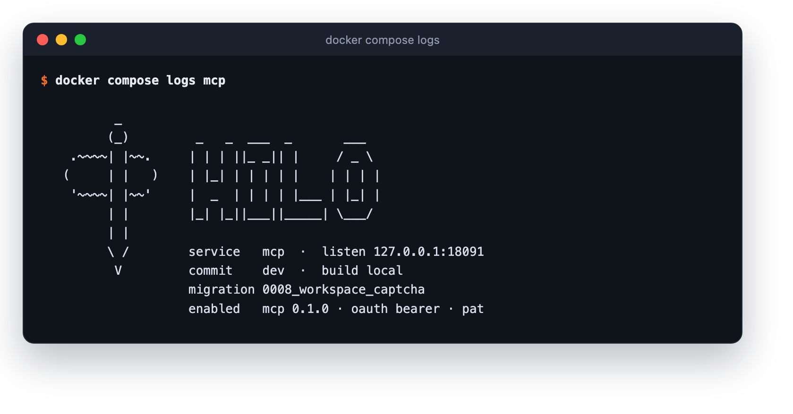
  <br><sub>Each service prints a banner at startup with its commit, migration and what is enabled.</sub>
</p>

## Connect an agent

MCP server URL: `https://<your-domain>/mcp`

- **Claude (web/desktop)**: Settings → Connectors → *Add custom connector* → paste the URL. Hilo opens so you can sign
  in and authorize; you pick the workspace and, if you want, read-only access.
- **Claude Code**: `claude mcp add --transport http hilo https://<your-domain>/mcp`
- **Grok (xAI API)**: tool `{"type": "mcp", "server_url": "https://<your-domain>/mcp", "authorization":
  "hilo_pat_…"}` in `/v1/responses` (the token alone: xAI adds `Bearer`). To try it against your local stack, tunnel
  included: `./scripts/try-grok.py`.
- **ChatGPT, Cursor, Duet, Muse and others**: add the URL as a remote MCP server ([compatibility and per-client
  guide](docs/AGENTS.md), in Spanish). If the client doesn't support OAuth, create a personal token in
  *Settings → Agents* and send it as `Authorization: Bearer hilo_pat_…`.

### MCP tools

The server exposes 25 tools: everything an agent needs to run the CRM, and nothing more.

| For | Tools |
|---|---|
| **Search and read** (13): know what happened before acting | `search_crm` by name, domain, email or title · `list_companies`, `list_contacts` filterable by text, owner or tag · `list_opportunities` by stage, status, owner, channel, close date or days without activity · `list_interactions` · `list_pipelines`, `list_channels`, `list_tags` to avoid inventing duplicates · `get_company`, `get_contact`, `get_opportunity` · `get_timeline` (interactions and stage changes) · `get_metrics` |
| **Write** (6): record what the agent did or saw | `upsert_company`, `upsert_contact` (by id, `external_id`, domain or email) · `upsert_opportunity` (amount, probability, close date, next step, owner, channel and links) · `move_opportunity_stage` (moving to lost requires a reason) · `log_interaction` (email, call, meeting, note, message, social or form; inbound, outbound or internal) · `archive_record` (deletes nothing: takes the record out of lists and keeps it in the history and the audit) |
| **Batch work** (1): migrate in a few calls | `bulk_upsert`: up to 200 records per call, with `dry_run` to validate a whole migration without saving |
| **Agents that come back on their own** (2) | `needs_attention`: open opportunities that need someone, with the reason (next step overdue, close date passed, no activity, no owner, no next step) · `list_changes`: everything that changed, with a cursor, telling apart whether a person, an agent or a form did it |
| **Administration** (3): admins only | `configure_pipeline` (stages in order, with category and probability) · `upsert_channel` · `export_records` (companies, contacts or opportunities as CSV, in parts for large workspaces) |

References between records accept Hilo's id, the natural key (company domain, contact email) or the source system's
`external_id`, so an agent that syncs or migrates doesn't need to keep ids.

Each agent sees only the tools its role and its token allow. An OAuth or personal token can be restricted to read-only;
it can never widen what the role allows.

### Pipelines and channels

Each stage has a free name and one of four categories: `initial` (exactly one), `in_progress` (at least one), `won`
and `lost` (at least one of each). An opportunity's status follows its stage's category, so metrics don't depend on
what you named the columns.

Each stage also has a probability, and that is what makes the weighted amount mean something: the sales pipeline comes
with Lead 10 %, Qualified 25 %, Proposal 50 %, Negotiation 75 %, Won 100 % and Lost 0 %. A pipeline can be marked as
the default and have a monthly goal with a currency. If a stage is deleted, its opportunities have to be reassigned.

Channels exist to answer one question: what brings deals, not just visits. Ten come out of the box (Email, Event,
Form, LinkedIn, Outbound, Referral, Phone, Video, Video call and Web), and each has a type: `web`, `form`, `email`,
`phone`, `social`, `referral`, `event`, `outbound`, `partner`, `ads`, `videocall`, `video` or `other`.

`get_metrics` measures open volume and weighted value per stage; won and lost with amounts and win rate; average cycle
and days in each stage; stalled opportunities (14 days without activity) and new ones per channel; interactions per
week and progress against the month's goal. The default window is 90 days.

### Lead forms

Public lead forms create contact + opportunity + interaction, without being able to overwrite existing data. Each form
can require a Cloudflare Turnstile captcha (free), which Hilo verifies on the server before saving. The keys belong to
each workspace and an admin enters them in the interface, without touching the server. If the form has allowed
origins, the captcha must have been solved on one of those sites.

To turn it on, a workspace admin:

1. At [dash.cloudflare.com](https://dash.cloudflare.com), goes to **Turnstile → Add widget** with the domains of the
   websites where the forms live. Cloudflare gives a public key (site key) and a secret one (secret key).
2. In **Settings → Forms → Captcha**, pastes both keys and presses **Save keys**. The secret is stored encrypted and is
   never shown again: the screen says it is saved and shows its last 4 characters.
3. Copies the form's snippet to the website (it already includes the Turnstile script and widget) and then presses
   **Require captcha** on that form.

Keep that order: if the captcha is turned on before the website has the widget, the form rejects every submission.
Without saved keys Hilo won't let you turn it on, and it won't let you remove them while a form requires it. New forms
come with the captcha on; existing ones stay without it until it is turned on.

## Who can sign in

A Google- or Microsoft-verified email whose domain is enabled by a superadmin, or one with a pending invitation.
Without configured domains, only superadmins and invited people. Superadmins are defined with `SUPERADMIN_EMAILS` or
with `hiloctl superadmin grant <email>`.

Nobody joins a workspace without accepting: invitations, and the ones a workspace offers to everyone with its email
domain, wait on the invitations page until the person accepts or declines them. An admin can only list the domain of
their own email. Only the operator (`hiloctl member add`) adds people directly.

| Role | Can |
|---|---|
| Viewer | read |
| Member | read and write CRM data |
| Admin | also configure pipelines, channels, forms, members and domains |
| Owner | also manage owners |
| Superadmin (platform) | domains allowed to sign in, application branding and a view of every workspace |

### An agent has no more permissions than a person

Every agent call goes through the same permission rules and the same audit as if a person had made it.

- **Separate scopes.** The server distinguishes `crm:read`, `crm:write` and `crm:admin`. Admin includes configuring
  pipelines and channels, and using historical dates for migrations. A read-only token really is read-only.
- **Who did what.** `list_changes` and the audit tell apart whether a change was made by a person, an agent or a form.
- **Full history.** Everything shows in each opportunity's timeline and in the workspace audit log.
- **Archiving is not deleting.** `archive_record` takes the record out of lists and keeps it in the history and the
  audit.

## Administer from the terminal

Everything about workspaces, members and tokens can be done without opening the web, with `hiloctl` inside the `web`
container (on the server, over SSH):

```sh
docker compose exec web hiloctl workspace create "Acme" --owner ana@acme.com --lang en
docker compose exec web hiloctl member add acme bob@acme.com member      # if they never signed in, they are invited
docker compose exec web hiloctl token create acme ana@acme.com grok --read-only --ttl 90d
docker compose exec web hiloctl --json member list acme
docker compose exec web hiloctl client preapprove acme <client-id-url>     # copied from Settings → Agents
docker compose exec web hiloctl watch acme                                # what agents are doing, live
docker compose exec -T web hiloctl pipeline apply acme < pipeline.json    # pipelines, channels, audit, branding…
docker compose exec -T web hiloctl export acme > acme.json                 # the whole workspace, as JSON
docker compose exec -T web hiloctl import other --dry-run < acme.json      # validate; without --dry-run, load
docker compose exec -T web hiloctl import-csv acme contact --source hubspot --dry-run < contacts.csv   # a CSV from another CRM
```

Full manual, with steps and recipes: [docs/HILOCTL.md](docs/HILOCTL.md) (in Spanish).

<p align="center">
  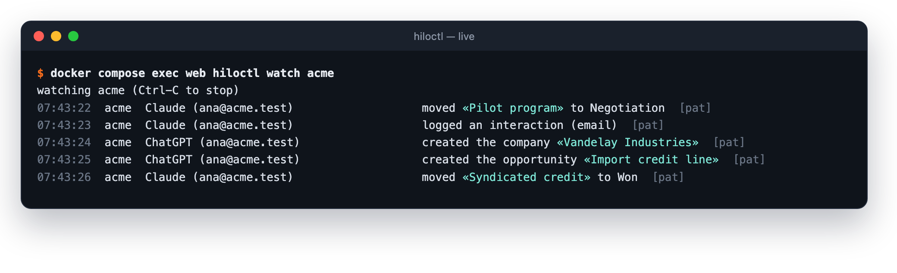
  <br><sub><code>hiloctl watch</code>: every change as it happens, and which agent made it for whom.</sub>
</p>

| | |
|---|---|
| 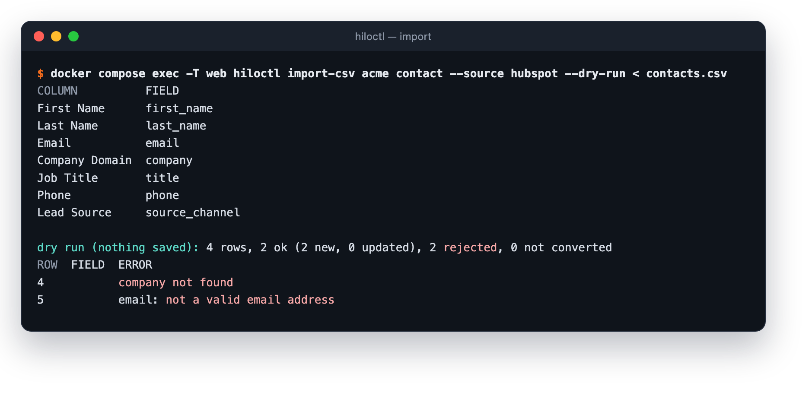 | 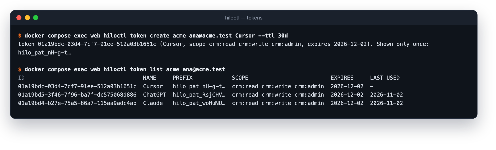 |
| **Import a CSV** from another CRM: column mapping and a dry run before saving. | **Personal tokens** for agents without OAuth, shown only once. |

`export` produces the same format `import` reads (and the `bulk_upsert` tool): it works as a readable backup, to move a
workspace to another Hilo and as the format for large migrations without an agent. Importing it again never
duplicates.

A CSV from another CRM or a spreadsheet is loaded from *Settings → Import* (one record type per file: Hilo recognizes
columns in Spanish or English, lets you adjust them and validates everything with a dry run before saving) or with
`hiloctl import-csv` for large files. Both go through the same `upsert`s the agents use.

*Settings → Export* downloads companies, contacts or opportunities as CSV, one file per type, in the columns Import
reads: the files load as they are into another workspace (companies, then contacts, then opportunities). Agents get
the same files with `export_records`. Only admins export, and every export is recorded in the audit log.

`hiloctl` with no arguments lists every command. It acts as the server operator, with the same rules as the web (for
example, no workspace is ever left without an owner). The token is shown only once.

With `HILO_UI=minimal` the web is reduced to what agents' OAuth needs (sign-in and consent) and everything else is
administered with `hiloctl`; with `HILO_UI=off` there are no pages and no OAuth, and agents sign in with personal
tokens issued by `hiloctl`.

A pre-approved agent connects without a consent screen: the person only picks their Google or Microsoft account (if a
single provider is configured, Hilo goes straight to it). It is pre-approved with the URL that identifies the agent
(its `client_id`, visible in *Settings → Agents* after connecting it once), with read and write or read-only, and never
with administration permissions.

## Architecture

```
                 ┌──────────── edge ─────────────┐        ┌──────── data (internal) ───────┐
 browser ───┐    │  caddy ──► web  (UI, OAuth,   │        │                                │
 agents ────┴──► │   TLS       forms)        ────┼────────┼──► postgres (RLS)  ◄── migrate │
   (MCP)         │        └─► mcp  (/mcp)    ────┼────────┼──►                 ◄── backup  │
                 └───────────────────────────────┘        └────────────────────────────────┘
```

| Container | Role |
|---|---|
| `caddy` | The only exposed endpoint. Automatic TLS (Let's Encrypt), body limit, compression. |
| `web` | Google/Microsoft sign-in, OAuth consent, board, dashboard, settings, superadmin, form endpoint. |
| `mcp` | Stateless MCP server. It only validates tokens; it never issues them. |
| `db` | Postgres 18. No published ports, on a network with no internet access. |
| `migrate` | Applies migrations with the `hilo_migrator` role and exits. |
| `backup` | Daily compressed `pg_dump`, with configurable retention. |

Stack: Go 1.27, `net/http`, pgx + sqlc (typed SQL, no dynamic SQL), the official MCP Go SDK, `html/template`,
Postgres 18, Caddy 2.

## Security

It is meant to run exposed to the internet, because a remote MCP server has to be.

- Remote MCP (Streamable HTTP) with **OAuth 2.1**: dynamic client registration, Client ID Metadata Documents,
  mandatory PKCE, refresh token rotation and personal tokens for clients without OAuth.
- **Multi-workspace** with Postgres Row-Level Security and composite per-workspace foreign keys.
- Least-privilege database roles, rootless read-only containers.
- Strict CSP.
- Third-party secrets that admins enter in the UI (such as the captcha key) are stored encrypted with AES-256-GCM.

## Development and quality harness

```sh
make hooks     # pre-commit: formatting, secrets in staged files, lint
make test      # unit, integration and E2E tests against real Postgres (with -race and coverage)
make check     # everything CI runs: formatting, generated code, lint, tests, govulncheck, gitleaks, hadolint, Trivy
make dast      # OWASP ZAP baseline against the running stack (make up)
```

| Layer | Tool |
|---|---|
| Lint and static security | golangci-lint: gosec, errcheck, dupl (repeated code), gocognit, staticcheck, revive… |
| Secrets | gitleaks (tree and full history) with rules for Hilo's tokens |
| Dependencies | govulncheck, Trivy, Dependabot |
| Containers | hadolint, Trivy on the images |
| Tests | tenant isolation, permission matrix, full OAuth flow with attacks, CSRF, XSS, open redirect, fuzzing, translation catalogs |
| DAST | OWASP ZAP baseline |

The interface translations live in `internal/i18n/locales/*.json`, keyed by the Spanish text. A test fails if any
message lacks a translation in any language.

## License

[Apache-2.0](LICENSE): free for commercial and private use.

Documentation (in Spanish): [deployment (Docker, Lightsail, EC2 + Aurora)](docs/DEPLOY.md) ·
[hiloctl manual](docs/HILOCTL.md) · [security and threat model](SECURITY.md) ·
[startup banner](docs/STARTUP_BANNER.md) · [migrating from another CRM with an agent](docs/migrate/README.md) ·
[contributing](CONTRIBUTING.md) · [feature roadmap](docs/PLAN_FEATURES.md).
